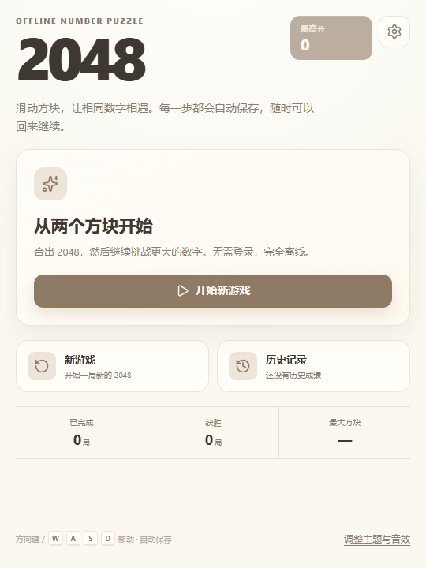
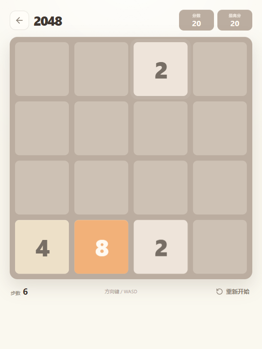
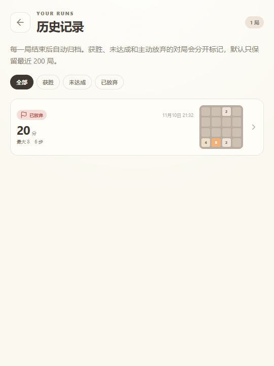
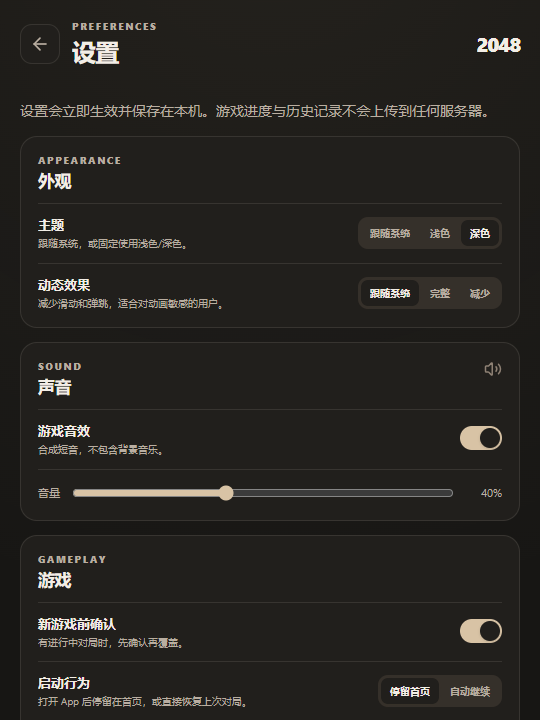

# 2048 Desktop

一个使用 **Tauri 2 + React + TypeScript** 构建的离线 2048 桌面游戏。自动保存进度，支持继续游戏、历史记录、主题与音效设置，最终打包为 Windows 安装包。

> 设计文档：[docs/2048-app-design.md](docs/2048-app-design.md)

| 首页 | 游戏 |
| --- | --- |
|  |  |

| 历史记录 | 深色设置 |
| --- | --- |
|  |  |

## 功能

- 经典 4×4 2048 规则，达成 2048 后可继续挑战。
- 每次有效移动自动保存，关闭后重新打开可继续。
- 进行中只保留一局，开新局会按结果归档。
- 历史记录：获胜 / 未达成 / 已放弃筛选、终局棋盘、详情与删除/清空。
- 设置：跟随系统/浅色/深色主题、减少动态、音效与音量、新游戏确认、启动行为。
- 键盘方向键/WASD、鼠标拖拽与触屏滑动。
- 完全本地运行，无账号、无网络请求、无遥测。
- Windows NSIS 安装包，单实例运行。

## 技术栈

- Tauri 2 + Rust 本地文件存储
- React 19 + TypeScript + Vite
- Zustand 状态管理
- Zod 本地数据校验
- Vitest 单元测试
- CSS 设计令牌与原生 CSS 动画

## 开发环境

- Node.js 20+
- Rust stable（MSVC toolchain）
- Visual Studio Build Tools（C++ 桌面开发）
- WebView2 Runtime（Windows 10/11 通常已安装）

```powershell
npm install
npm run tauri dev
```

仅运行网页版本（使用浏览器 localStorage 作为开发态存储）：

```powershell
npm run dev
```

## 构建

```powershell
npm run build          # 前端类型检查与生产构建
npm test               # 引擎与存储逻辑单元测试
npm run tauri build    # Windows 安装包
```

Windows 安装包输出在：

```text
src-tauri/target/release/bundle/nsis/
```

当前可分发版本已复制到 `release/2048_0.1.0_x64-setup.exe`，并附带 `release/SHA256SUMS.txt`。安装包未做代码签名，Windows SmartScreen 可能提示未知发布者；正式分发前应配置代码签名证书。

## 安装包

| 文件 | 说明 |
| --- | --- |
| `release/2048_0.1.0_x64-setup.exe` | Windows 10/11 x64 单用户安装包，约 2 MB |
| `release/SHA256SUMS.txt` | 安装包 SHA-256 校验值 |

## 本地运行

- **安装版**：双击 `release/2048_0.1.0_x64-setup.exe` 安装，然后从开始菜单启动。
- **免安装版**：双击项目根目录的 `run.cmd`。脚本会使用 `.runtime\data` 作为本地数据目录并启动编译好的应用。
- **直接运行可执行文件**：

```powershell
$env:GAME2048_DATA_DIR="E:\Project\2048\.runtime\data"
.\src-tauri\target\release\game2048.exe
```

普通安装版默认使用 `%APPDATA%\com.game2048.desktop`。`GAME2048_DATA_DIR` 会同时覆盖 Tauri 的应用目录和 WebView2 数据目录，适合便携运行或把数据放在项目内。

## 快捷键

| 按键 | 功能 |
| --- | --- |
| 方向键 / WASD | 移动方块 |
| Esc | 关闭弹窗 |
| 鼠标拖拽 / 触屏滑动 | 移动方块 |

## 数据位置

运行时数据保存在 Tauri 的 `app_data_dir`，Windows 下通常为：

```text
%APPDATA%\com.game2048.desktop\
  profile.json
  session.json
  history.json
  backups\
  corrupt\
```

- `profile.json`：设置、最高分、累计统计。
- `session.json`：当前对局，关闭后自动保存。
- `history.json`：最近 200 局。
- 写入采用临时文件、同步和原子替换；读取失败时回退到 `.bak`。

重置全部数据会删除上述文件。清空历史只删除历史记录，不影响当前对局和最高分。

调试或做便携式运行时，可用 `GAME2048_DATA_DIR` 覆盖数据目录；它会同时影响 Tauri 应用目录和 WebView2 数据目录，普通用户无需设置。

## 项目结构

```text
src/
  game/         纯 TypeScript 游戏引擎与规则测试
  storage/      Repository、Zod 数据校验与完成对局逻辑
  store/        Zustand 应用状态与自动保存队列
  pages/        首页、游戏、历史、详情、设置
  components/   棋盘、弹窗、结果层、Toast 等
  lib/          格式化与 Web Audio 音效
src-tauri/
  src/storage.rs  原子文件读写、备份、归档
  src/lib.rs      Tauri 命令与单实例窗口
  tauri.conf.json 窗口、CSP 与 NSIS 配置
docs/
  2048-app-design.md
```

## 隐私

游戏不发送网络请求，不收集设备信息、崩溃信息或使用数据。所有数据仅保存在本机。

## License

MIT
