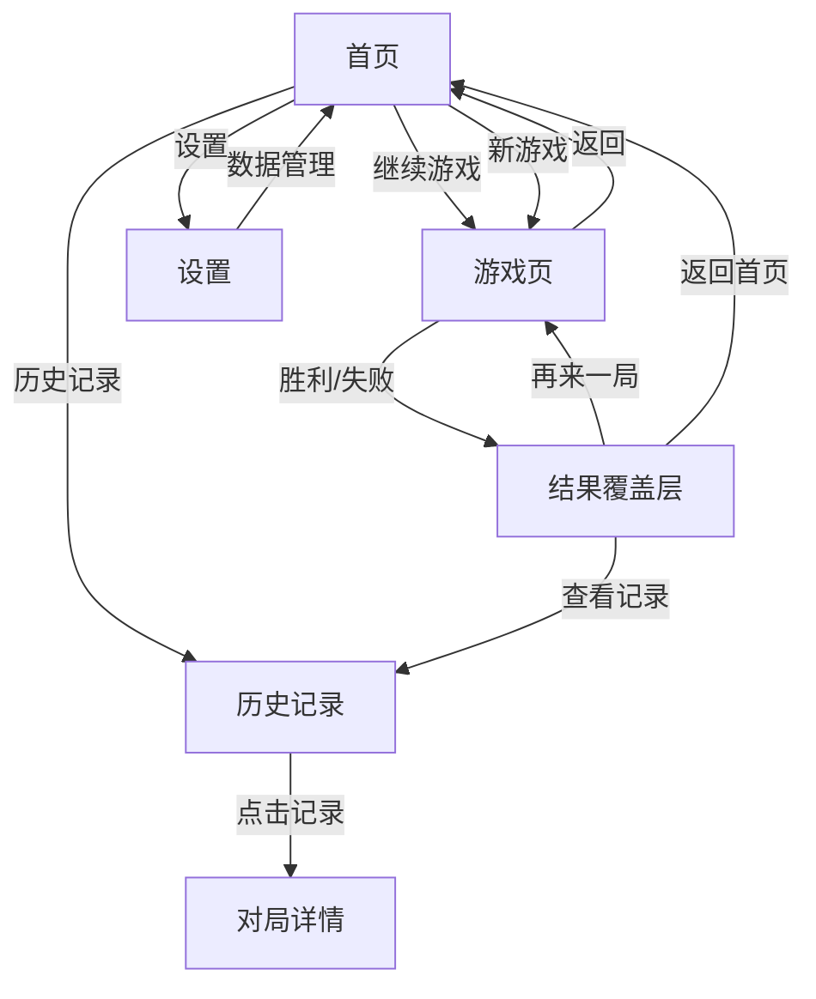
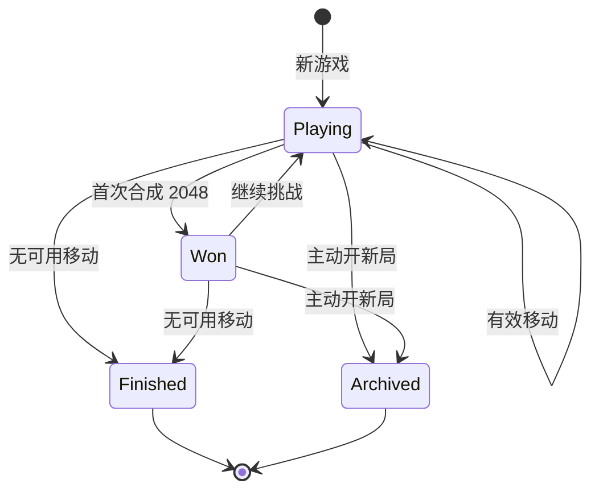
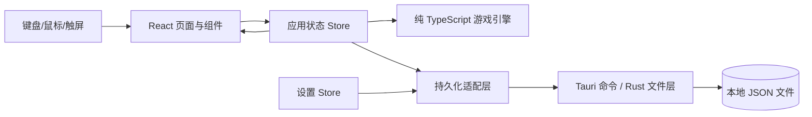

# 2048 App 产品与实现方案

> 文档版本：v1.0  
> 日期：2026-11-10  
> 状态：已实现 v0.1.0  
> 交付目标：设计已落地为可运行的 Windows 桌面应用，并保留后续迭代空间  
> 结论：在“Windows 桌面优先、单机离线、可安装 App”的默认前提下，**选定方案 B：Tauri 2 + React + TypeScript 桌面应用**。完整的候选方案对比见第 9 节。

---

## 1. 方案摘要

要做的不只是一个 2048 棋盘，而是一个可持续游玩的小型单机 App。核心体验围绕三条主线：

1. **随时继续**：每次有效移动自动保存，重新打开 App 可以从首页一键恢复，不要求用户手动存档。
2. **有迹可循**：每局结束自动进入历史记录，可以查看得分、最大方块、步数和终局棋盘，并支持筛选、删除与清空。
3. **可调可配**：主题、动画、音效、新游戏确认、启动行为等设置即时生效并持久化。

产品形态建议：

| 项目 | 结论 |
| --- | --- |
| 首发平台 | Windows 10/11 x64 桌面安装包 |
| 游戏规则 | 经典 4×4、2048 达成后可继续挑战 |
| 数据策略 | 完全本地、离线可用、无账号、无网络请求 |
| 应用形态 | 单窗口桌面 App，NSIS 安装包 |
| 技术路线 | Tauri 2 + React + TypeScript + Vite |
| 持久化 | 本地 JSON 文件 + 原子写入 + 备份 + 版本迁移 |
| 后续扩展 | macOS/Linux、移动端、撤销、回放、5×5 模式 |

推荐方案的核心判断是：2048 的界面和交互高度 Web 化，适合用 React 快速做好；但“打包成 App”要求安装包、离线能力和可靠本地存储，Tauri 在体积、启动速度、系统集成之间比纯 PWA 和 Electron 更均衡。

### 1.1 一页速选

| 方案 | 形态 | 最适合 | 主要代价 | 结论 |
| --- | --- | --- | --- | --- |
| A PWA | 可安装网页 | 最快验证、网页交付 | 不像独立 App，存储可靠性较弱 | 备选 |
| B Tauri 2 | 轻量桌面 App | Windows 桌面、小体积、离线 | 需要 Rust 构建链，依赖 WebView2 | **推荐并选定** |
| C Electron | 桌面 App | 团队已有 Electron 基础设施 | 安装包和内存明显更大 | 备选 |
| D Capacitor | Android/iOS App | 手机应用商店为首发 | 需要移动端构建链与双端测试 | 移动优先时选 |

详细比较、评分和选择理由见第 9 节。

---

## 2. 目标与非目标

### 2.1 产品目标

- **即开即玩**：冷启动后 5 秒内可以开始或继续一局。
- **不丢进度**：正常退出、强制结束进程、系统重启后，最多丢失最后一次有效移动。
- **操作顺手**：键盘方向键/WASD 和鼠标拖拽都可用；同时支持触屏滑动。
- **结果可回顾**：历史记录不是简单日志，而是能看懂的一局“成绩单”。
- **设置有意义**：每个设置都影响实际体验，不做装饰性开关。
- **像 App**：有安装包、应用图标、独立窗口、离线运行，不依赖浏览器标签页。
- **可维护**：游戏规则与界面解耦，后续增加棋盘尺寸、撤销、主题时不需要推翻重写。

### 2.2 成功指标（首个版本）

| 指标 | 目标 |
| --- | --- |
| 首次启动到可操作 | ≤ 2 秒（热启动 ≤ 1 秒） |
| 安装包体积 | ≤ 15 MB |
| 运行时内存 | 常规情况 < 150 MB |
| 动画帧率 | 主流 Windows 设备稳定 60 FPS |
| 输入响应 | 按键到棋盘状态变化 < 50 ms |
| 数据可靠性 | 异常退出后存档可恢复；不出现无法启动的损坏存档 |
| 离线能力 | 断网时所有功能完整可用 |
| 可访问性 | 键盘可完成全部核心流程，支持减少动态效果 |

### 2.3 非目标（P0 不做）

- 账号体系、云同步、跨设备同步。
- 在线排行榜、好友对战、多人模式。
- 广告、内购、体力系统。
- AI 自动游玩或提示最优解。
- 对局视频、完整回放（可作为 P1）。
- macOS/Linux/移动端正式发行（架构保留，不在首版验收范围）。
- 后台常驻、开机自启、系统托盘。
- 多语言完整翻译（首版中文，文案集中管理）。

---

## 3. 用户与使用场景

### 3.1 目标用户

- **碎片时间玩家**：工作间隙或通勤时玩一两局，希望打开就能继续。
- **轻中度挑战者**：在意最高分和最大方块，会回看历史成绩。
- **桌面效率用户**：偏好键盘操作，不希望游戏常驻浏览器标签页。
- **外观敏感用户**：会调整深色模式、动画强度和音效。

### 3.2 关键场景

| 场景 | 用户动作 | 产品响应 |
| --- | --- | --- |
| 上次没玩完 | 打开 App | 首页突出显示“继续游戏”，展示当前分数、最大方块和步数 |
| 想重新开始 | 点击“新游戏” | 有进行中对局时二次确认，确认后旧局归档，新局开始 |
| 刚输掉一局 | 查看结果 | 展示终局覆盖层，可直接“再来一局”或“查看记录” |
| 想看最好成绩 | 打开历史记录 | 按时间倒序展示，支持按结果筛选，点击查看终局棋盘 |
| 不喜欢动画 | 打开设置 | 切换为减少动态，立即生效并在下次启动保持 |
| 换电脑/重装 | 重装 App | 首版不承诺跨设备迁移；P1 提供导入/导出 |

### 3.3 核心用户故事

- 作为玩家，我重新打开 App 时，希望能看到上次的对局并一键继续，而不是重新开始。
- 作为玩家，我希望新游戏不会无声无息地覆盖旧进度；如果会覆盖，应明确告知。
- 作为玩家，我希望看到每局结束后的得分、最大方块、步数和终局棋盘。
- 作为玩家，我希望能关闭音效和动画，而不影响游戏功能。
- 作为玩家，我希望删除历史或重置数据前有明确确认，避免误操作。

---

## 4. 功能范围与优先级

### 4.1 P0：首个可交付版本

| 模块 | 功能 |
| --- | --- |
| 首页 | 品牌标题、最高分、继续游戏卡片、新游戏、历史记录、设置入口 |
| 新游戏 | 创建 4×4 新局；有进行中对局时二次确认；旧局按规则归档 |
| 继续游戏 | 自动恢复棋盘、分数、步数、随机数状态和胜利状态 |
| 游戏 | 方向键/WASD、鼠标拖拽、触屏滑动；合并、计分、生成新方块 |
| 胜负 | 首次达到 2048 展示胜利层，可继续挑战；无可用移动时结束 |
| 自动保存 | 每次有效移动后保存；退出/关闭窗口前强制落盘 |
| 历史记录 | 列表、结果筛选、详情、单条删除、清空；最多保留 200 局 |
| 设置 | 主题、动态效果、音效与音量、新游戏确认、启动行为、数据管理、关于 |
| 数据管理 | 清空历史、重置全部数据；操作前二次确认 |
| 打包 | Windows NSIS 安装包、应用图标、版本号、单实例运行 |
| 异常处理 | 存档损坏可回退备份或安全重建，不阻塞启动 |

### 4.2 P1：增强版本

- 一步撤销。启用撤销的对局标记为“辅助模式”，不计入最高分，历史中单独标识。
- 对局回放：保存移动序列，按步重放终局过程。
- 5×5 / 6×6 棋盘，独立最高分与历史筛选。
- 历史导出/导入 JSON，支持换机迁移。
- 更多主题、方块皮肤、色盲友好配色。
- 每日挑战或固定种子模式。
- macOS/Linux 安装包。
- 移动端 Capacitor 包装与触觉反馈。

### 4.3 P2：长期可选

- 云同步与账号。
- 全球排行榜。
- 成就系统。
- 自定义按键与手柄支持。

### 4.4 关键范围决策

| 决策 | 选择 | 理由 |
| --- | --- | --- |
| 同时保存几局 | 只保留 1 局进行中对局 | 符合 2048 的轻量心智，避免“存档管理”复杂度 |
| 是否手动存档 | 否，自动保存 | 降低用户负担，避免忘记保存 |
| 放弃的对局是否进历史 | 是，标记为“已放弃” | 避免进度无声消失，同时保留统计完整性 |
| 首版是否支持撤销 | 否 | 撤销会影响最高分公平性与状态复杂度，放到 P1 |
| 首版棋盘尺寸 | 固定 4×4 | 保持经典规则与验收范围可控 |
| 首版是否联网 | 否 | 单机游戏不需要后端，减少隐私与运维成本 |
| 启动后去哪 | 首页（默认） | 继续按钮足够醒目；直接进游戏会让“想开新局”的用户多一步 |
| 启动自动继续 | 可选，默认关闭 | 尊重用户预期，不强行跳过首页 |

---

## 5. 信息架构与导航

### 5.1 页面结构



建议使用 `HashRouter`，路由稳定、无需服务端回退配置，适合 Tauri 静态资源加载：

- `#/` 首页
- `#/game` 当前对局
- `#/history` 历史列表
- `#/history/:gameId` 对局详情
- `#/settings` 设置

### 5.2 首页

首页承担“继续优先”的决策，而不是简单的菜单页。

```text
┌────────────────────────────────────┐
│  2048                       ⚙     │
│  最高分  12,340                    │
│                                    │
│  ┌──────────────────────────────┐  │
│  │ 继续游戏                   → │  │
│  │ 分数 2,048 · 最大 64 · 128 步 │  │
│  │ 3 分钟前                      │  │
│  └──────────────────────────────┘  │
│                                    │
│  [ 新游戏 ]  [ 历史记录 ]  [ 设置 ]│
│                                    │
│  方向键 / WASD 移动方块            │
└────────────────────────────────────┘
```

状态规则：

| 状态 | 首页表现 |
| --- | --- |
| 无进行中对局 | 主按钮为“开始新游戏”；不显示空的继续卡片 |
| 有进行中对局 | 主按钮为“继续游戏”；继续卡片展示摘要；“新游戏”为次要按钮 |
| 对局已达成 2048、尚未关闭胜利层 | 继续卡片文案为“继续挑战”，仍可恢复 |
| 存档损坏且备份不可用 | 显示轻量提示“上次进度无法恢复”，提供“开始新游戏”，不阻塞使用 |
| 存档版本过旧 | 自动迁移；迁移失败则按损坏处理并保留原始文件副本 |

交互细节：

- “继续游戏”是默认主操作，`Enter` 可直接进入。
- “新游戏”在有进度且开启“新游戏确认”时弹出确认框，文案明确说明旧局会进入历史记录；关闭确认后直接归档并开始新局。
- 如果当前对局尚未产生任何有效移动（步数为 0），点击“新游戏”直接替换为初始局面，不弹确认、不写历史；已有步数时按“新游戏确认”设置处理并归档。
- 最高分实时来自本地统计，不从历史列表临时计算，避免历史裁剪后丢失。
- 首页不播放背景音乐，避免启动即打扰。

### 5.3 游戏页

```text
┌────────────────────────────────────┐
│  ←    2048          分数    最高分 │
│                        2,048  12,340│
│                                    │
│  ┌────┬────┬────┬────┐             │
│  │  2 │  4 │    │    │             │
│  ├────┼────┼────┼────┤             │
│  │  8 │ 16 │  2 │    │             │
│  ├────┼────┼────┼────┤             │
│  │ 32 │    │    │    │             │
│  ├────┼────┼────┼────┤             │
│  │  4 │    │  2 │    │             │
│  └────┴────┴────┴────┘             │
│                                    │
│  步数 128                [重新开始] │
└────────────────────────────────────┘
```

- 左上角返回首页：自动保存后返回，不弹“是否保存”。
- 重新开始：等同于“新游戏”，按“新游戏确认”设置处理。
- 合并时在方块上浮出 `+分数` 的轻量提示，不打断操作。
- 分数变化用 120–180 ms 的数字跳动；最高分只在被刷新时强调。
- 棋盘最大宽度约 520 px，窗口拉大时整体居中，不把格子拉得过大。
- 输入锁定：一次移动动画期间不接受下一次移动，避免视觉与状态错位；锁定时间控制在 100–120 ms。

#### 结果覆盖层

| 结果 | 文案 | 操作 |
| --- | --- | --- |
| 首次达到 2048 | “达成 2048！” | 继续挑战 / 新游戏 / 返回首页 |
| 无可用移动，从未达到 2048 | “本局结束” + 得分、最大方块、步数 | 再来一局 / 查看记录 / 返回首页 |
| 无可用移动，曾达到 2048 | “挑战结束” + 最高成就 | 再来一局 / 查看记录 / 返回首页 |

胜利层在每个对局中只会在“尚未处理”时出现；点击“继续挑战”后永久关闭，本次对局不再重复弹出。若在点击前直接关闭 App，重新打开后会再次展示该层，不会丢失“已达成 2048”的事实。胜利时对局尚未结束，因此该覆盖层不提供“查看记录”，避免指向一条还不存在的历史。若此时点击“新游戏”，按“新游戏确认”设置处理；确认或直接开始后，将当前对局按“获胜”归档。

结束层若归档失败，必须明确显示“保存失败，请重试”，并暂时禁用“再来一局/查看记录”，避免用户以为成绩已保存而继续下一局。

### 5.4 历史记录

列表按结束时间倒序，每张卡片展示：

- 结果标签：获胜 / 未达成 / 已放弃。
- 得分、最大方块、步数。
- 结束日期与时间（如 `11 月 10 日 20:42`）。
- 终局棋盘缩略色块（可选但推荐）。

筛选：全部 / 获胜 / 未达成 / 已放弃。  
排序：首版只提供“最新优先”，避免过多控制项。  
详情：完整 4×4 终局棋盘、成绩摘要、对局时间、操作按钮“再来一局”。若当前存在进行中对局，点击“再来一局”时按“新游戏确认”设置处理，并归档旧局。  
删除：单条删除即时生效；清空历史需二次确认。

空状态文案要提供下一步动作，而不是只显示“暂无数据”：

> 还没有历史记录。完成一局后，成绩会自动保存在这里。  
> [开始新游戏]

空状态的主按钮按当前状态变化：存在进行中对局时显示“继续游戏”，否则显示“开始新游戏”。

历史语义：

- 达到过 2048 后结束，或达到 2048 后主动开新局，记录为“获胜”。
- 从未达到 2048 且无可用移动，记录为“未达成”。
- 从未达到 2048、已有有效移动，但主动开新局，记录为“已放弃”。
- “重置全部数据”是破坏性操作，不归档当前对局，直接删除当前对局、历史、统计和设置。
- 历史最多保留 200 局，超出后按结束时间淘汰最旧记录；最高分和累计统计独立保存，不受淘汰影响。

### 5.5 设置

设置按组呈现，修改即保存，不设置“保存”按钮。

**外观**

- 主题：跟随系统 / 浅色 / 深色。
- 动态效果：跟随系统 / 完整 / 减少。
  - 跟随系统时读取 `prefers-reduced-motion`。
  - 减少动态时关闭滑动与弹跳，仅保留短暂淡入。

**声音**

- 音效开关（默认开启）。
- 音量滑杆 0–100%（默认约 40%）。
- 说明：音效由 Web Audio 合成，不含第三方版权素材；首次用户操作后才启动音频上下文。

**游戏**

- 新游戏前确认（默认开启）。
- 启动行为：停留在首页 / 自动继续上次对局（默认停留在首页）。选择自动继续时，只有存在可恢复对局才直接进入游戏，否则仍回首页。
- 显示键盘提示（默认开启）。

**数据**

- 清空历史记录：只删除历史，不影响当前对局和最高分。
- 重置全部数据：删除当前对局、历史、最高分与设置，需二次确认。
- 显示当前数据占用空间的轻量说明（可选）。

**关于**

- 版本号、构建时间。
- 隐私说明：所有数据仅保存在本机，不收集遥测。
- 开源许可清单（P1 可选）。

桌面端不显示震动开关；若后续移动端上线，再根据平台能力显示。设置项不可用时隐藏而不是置灰，减少噪音。

### 5.6 通用交互

- 确认弹窗默认焦点在“取消”，`Esc` 关闭；危险操作按钮使用强调色。
- 删除、清空、重置等操作完成后使用 Toast 反馈，不使用阻塞式弹窗。
- 所有页面支持键盘焦点可见；不让游戏快捷键在输入框或弹窗内误触。
- 窗口关闭时若存在未落盘状态，先落盘再关闭；不向用户弹出技术性错误。

---

## 6. 游戏规则与状态机

### 6.1 规则定义

- 棋盘为 4×4，初始随机放置 2 个方块。
- 每次生成方块：90% 为 2，10% 为 4。
- 玩家向四个方向之一移动，所有方块尽可能向该方向滑动。
- 相邻且数值相同的方块合并，合并后的数值为两者之和，并计入得分。
- **每个方块每回合最多参与一次合并**。例如 `[2, 2, 2, 2]` 向左应得到 `[4, 4]`，而不是 `[8]`。
- 只有发生至少一次移动或合并时，才生成新方块；无效方向不生成、不计步。
- 每次有效移动的顺序固定为：压缩/合并 → 计分 → 在空位生成新方块 → 判断是否结束。
- 首次出现 2048 时触发胜利，但游戏继续；允许继续合成更大数值。
- 当棋盘已满且任意方向都无法移动时，游戏结束。

### 6.2 对局状态机



持久化状态与界面状态分开：

- `session.status` 只保存 `playing` / `won`，用于恢复时判断是否重新展示胜利层。
- “游戏结束”不保留进行中存档：先将本局写入历史，再删除当前对局。
- `hasWon` 一旦为真就保持，避免继续挑战后丢失“已获胜”结果。
- “主动开新局”统一进入 Archived 收尾：`hasWon=true` 记为“获胜”，否则记为“已放弃”；步数为 0 时不写历史。
- “重置全部数据”不进入状态机，属于直接清空本地数据的破坏性操作。

### 6.3 引擎设计原则

- **纯 TypeScript 引擎**：不依赖 React、DOM、存储或时间 API，输入状态与方向，输出新状态与移动结果。
- **方块带稳定 ID**：每个方块是 `{ id, value, row, col }`，用于滑动、合并、生成动画。仅存盘时序列化为数值矩阵，恢复时重新分配 ID。
- **确定性随机**：使用可注入种子的 PRNG（如 mulberry32），保存 `seed` 与 `rngState`。相同状态与操作可复现，便于测试和未来回放。
- **单一入口**：`move(direction)` 内部完成压缩、合并、计分、生成、胜负判断，返回不可变结果。
- **禁止 UI 直接改棋盘**：所有变更必须经过引擎命令，避免规则分叉。
- **不依赖计时**：首版不记录游戏时长，历史展示日期和步数，避免窗口挂起带来的时间统计歧义。

建议的引擎输出：

```ts
type MoveResult = {
  state: GameState;          // 新状态
  moved: boolean;            // 是否发生有效移动
  scoreDelta: number;        // 本次得分
  mergedValues: number[];    // 用于音效/特效
  spawnedTileId: number | null;
  reached2048: boolean;      // 是否本步首次达成
  gameOver: boolean;         // 移动后是否无路可走
};
```

### 6.4 关键边界情况

| 情况 | 处理 |
| --- | --- |
| 玩家向无法移动的方向按键 | 不生成方块、不计步、不写盘 |
| 连续快速按键 | 队列最多缓存 1 次输入，动画结束后消费；不丢关键操作，也不让状态跳跃 |
| 合并链 `[2,2,4]` | 先合并两个 2 为 4，新 4 不再与旧 4 合并 |
| 一次移动多组合并 | 全部结算后统一生成 1 个新方块 |
| 达到 2048 后继续 | 点击“继续挑战”后不再出现；未处理时恢复会再次展示，之后按普通对局处理 |
| 窗口失焦/最小化 | 不暂停规则；恢复时状态不变，动画不补播 |
| 关闭窗口 | 阻止关闭 → 落盘 → 再关闭；失败时提示并允许强制退出 |
| 存档损坏 | 尝试 `.bak`；仍失败则以空状态启动，原始损坏文件保留供诊断 |
| 历史写入与删除存档之间崩溃 | `gameId` 幂等 upsert；`lastFinishedGameId` 防止统计重复；启动时补完收尾 |
| 两个 App 实例同时运行 | 单实例插件激活已有窗口，避免并发写同一文件 |

---

## 7. 技术架构

### 7.1 分层



- **展示层**：React 页面、组件、动画、可访问性。
- **应用层**：Zustand store 负责页面状态、命令调度、错误提示、保存节流。
- **领域层**：纯游戏引擎，固定规则，最容易测试。
- **基础设施层**：Tauri 命令封装文件读写、原子替换、备份和迁移。
- **适配层**：浏览器开发态可使用 IndexedDB/localStorage 适配器；桌面版使用 Tauri 文件适配器。接口一致，便于在浏览器里跑 E2E。

### 7.2 前端模块划分

```text
src/
  app/                 # 应用入口、路由、错误边界、主题注入
  pages/               # Home / Game / History / HistoryDetail / Settings
  features/game/       # 游戏页面、棋盘、方块、分数、结果层
  features/history/    # 历史列表、筛选、详情
  features/settings/   # 设置表单与分组
  engine/              # 纯规则引擎、PRNG、类型、选择器
  persistence/         # Repository 接口、Tauri/浏览器实现、迁移
  stores/              # session、profile、ui 状态
  components/          # Button、Dialog、Toast、EmptyState 等
  styles/              # 设计令牌、主题、全局样式
  i18n/                # 中文文案集中管理
```

```text
src-tauri/
  src/
    main.rs
    storage.rs         # 原子写、备份、读取、清理
    commands.rs        # 对前端暴露的最小命令集
  capabilities/
    default.json       # 仅开放必要能力
  tauri.conf.json
  icons/
```

### 7.3 关键数据流

1. 用户按键/滑动 → 输入适配器识别方向。
2. 若正在动画锁定或存在模态框，忽略输入。
3. 调用 `engine.move(state, direction)`。
4. `moved === false`：不生成、不写盘，结束。
5. `moved === true`：更新 store，触发动画和音效；更新最高分。
6. 防抖/合并写入当前对局；窗口关闭时强制 flush。
7. 若 `gameOver`：写入历史 → 更新累计统计 → 删除当前对局 → 展示结果层。
8. 若首次 `reached2048`：更新 `hasWon`，写盘，展示胜利层。

### 7.4 技术选型

| 层 | 选择 | 理由 |
| --- | --- | --- |
| 桌面壳 | Tauri 2.x | 体积小、内存低、系统 WebView、安装包成熟 |
| UI | React + TypeScript | 生态成熟，组件化和测试成本低 |
| 构建 | Vite | 启动快，Tauri 官方支持良好 |
| 状态 | Zustand | 轻量，避免为 16 个格子引入重型状态框架 |
| 校验 | Zod | 对读入的本地 JSON 做运行时校验，防止损坏数据进入渲染层 |
| 样式 | 全局 CSS + CSS 变量 | 主题切换简单，不引入大型样式框架 |
| 路由 | React Router（HashRouter） | Tauri 静态资源下稳定，支持历史详情 |
| 图标 | lucide-react | 体积可控、风格统一 |
| 音效 | Web Audio API 合成 | 无外部音频版权与资源加载问题 |
| 单元测试 | Vitest | 与 Vite 配套，引擎测试快 |
| 组件测试 | React Testing Library | 面向用户行为，不测实现细节 |
| E2E | Playwright（浏览器模式） | 覆盖首页、对局、历史、设置主流程 |
| 打包 | Tauri Bundler | 生成 NSIS 安装包，后续可扩展 MSI |

版本策略：首次创建项目时锁定当时的最新稳定版本并提交 lockfile；不在设计阶段追逐预览版。引擎和存储层保持与 UI 框架解耦，降低未来升级成本。

### 7.5 为什么把存储放在 Rust 层

前端直接操作文件会扩大权限面，也难以保证“临时文件 + 原子替换”的一致性。建议由 `src-tauri` 提供窄接口：

```text
load_profile() -> Profile
save_profile(profile) -> void
load_session() -> Session | null
save_session(session) -> void
clear_session() -> void
load_history(limit) -> HistoryRecord[]
finish_game(record) -> void   // 历史 upsert、统计幂等更新、删除当前对局
clear_history() -> void
reset_all() -> void
```

约束：

- 路径由 Tauri `app_data_dir` 决定，前端不传任意路径。
- 所有写入使用同目录临时文件 + `fsync` + 原子替换（Windows 下使用 ReplaceFile 或等价机制），并保留上一版 `.bak`。
- 所有存储命令经同一把异步互斥锁串行化，避免并发写入互相覆盖。
- 写入成功后清理旧临时文件；启动时清理孤儿临时文件。
- 读取时进行 schema 版本检查；Rust 侧反序列化校验结构，前端入口再用 Zod 复核关键字段。
- 命令集最小化，不开放 shell、任意文件系统、HTTP 等高权限能力。
- 单实例插件避免两个进程并发写。

---

## 8. 数据与持久化设计

### 8.1 存储介质选择

首版使用 **本地 JSON 文件**，不引入 SQLite：

- 数据量小：1 个当前对局 + 最多 200 条历史 + 设置/统计。
- 可读可导出，排查问题方便。
- 原子写入和备份足以满足可靠性要求。
- 避免数据库迁移、打包体积和额外依赖。

当出现完整回放、海量历史、复杂统计查询时，再评估 SQLite；数据访问通过 Repository 接口隔离，迁移成本可控。

### 8.2 文件布局

由 Tauri 的 `app_data_dir` 决定根目录，Windows 下通常位于用户 AppData 的 Roaming 目录。逻辑结构：

```text
<app_data_dir>/
  profile.json       # 设置 + 最高分 + 累计统计
  session.json       # 当前对局（可为空）
  history.json       # 最近 200 局
  backups/
    profile.bak
    session.bak
    history.bak
  corrupt/
    <timestamp>-session.json   # 无法恢复时保留原始文件
```

三个主文件各自带 `schemaVersion`，避免一个文件迁移失败拖累全部数据。

### 8.3 数据结构草案

**profile.json**

```json
{
  "schemaVersion": 1,
  "settings": {
    "theme": "system",
    "motion": "system",
    "soundEnabled": true,
    "soundVolume": 0.4,
    "confirmNewGame": true,
    "launchBehavior": "home",
    "showKeyboardHints": true
  },
  "stats": {
    "bestScore": 0,
    "bestTile": 0,
    "gamesPlayed": 0,
    "gamesWon": 0
  },
  "lastFinishedGameId": null
}
```

`lastFinishedGameId` 是内部去重字段：只有与本次 `gameId` 不同才递增 `gamesPlayed` / `gamesWon`，防止崩溃后的收尾重放导致局数重复计算。`gamesPlayed` 包含已放弃对局，`gamesWon` 只统计结果为 `won` 的对局。

**session.json**

```json
{
  "schemaVersion": 1,
  "gameId": "0f9f7f6e-6a2b-4a3c-9f0d-2f4a1b7c8d90",
  "boardSize": 4,
  "cells": [
    [2, null, null, null],
    [null, 4, null, null],
    [null, null, null, null],
    [null, null, null, null]
  ],
  "score": 0,
  "moves": 0,
  "status": "playing",
  "hasWon": false,
  "seed": "b7d3c1a9",
  "rngState": 123456789,
  "nextTileId": 3,
  "startedAt": "2026-11-10T12:40:00.000Z",
  "updatedAt": "2026-11-10T12:42:10.000Z"
}
```

说明：

- `cells` 仅存数值，恢复时重新分配方块 ID；动画不需要跨进程保持 ID。
- `status` 只允许 `playing` / `won`。
- `seed` 与 `rngState` 保证恢复后生成序列一致，也方便复现问题。
- `gameId` 用于历史幂等写入，不能用时间戳替代。

**history.json**

```json
{
  "schemaVersion": 1,
  "records": [
    {
      "gameId": "0f9f7f6e-6a2b-4a3c-9f0d-2f4a1b7c8d90",
      "result": "won",
      "boardSize": 4,
      "score": 20480,
      "bestTile": 2048,
      "moves": 412,
      "startedAt": "2026-11-10T12:40:00.000Z",
      "endedAt": "2026-11-10T13:02:10.000Z",
      "cells": [[2048, 1024, 512, 256], [8, 16, 32, 64], [4, 2, 8, 4], [2, 4, 2, 2]]
    }
  ]
}
```

- 记录完整终局棋盘，用于详情页缩略图与复盘查看。
- 首版不存移动序列；P1 回放时增加独立 `moves` 数组或单独回放文件，避免主历史文件膨胀。
- 结果枚举：`won` / `lost` / `abandoned`。

### 8.4 写入策略

| 数据 | 触发时机 | 策略 |
| --- | --- | --- |
| session | 每次有效移动后 | 100 ms 合并写入；关闭窗口/失焦前强制 flush；只保留最新状态 |
| profile | 设置变更、最高分/最大方块刷新、对局统计变化 | 立即写，量小 |
| history | 对局结束、主动放弃 | 先写历史，再更新统计（按 `lastFinishedGameId` 去重），最后删除 session；`gameId` 幂等 upsert |
| 清空/重置 | 用户确认后 | 先写空状态，再清理备份；失败时保留旧数据并提示 |

可靠性要求：

- 任意一次写入失败，不得让内存状态与磁盘状态无声分叉；界面应提示“保存失败”，并保留重试。
- App 被强制结束，最多丢失最后一次移动，不能产生半个 JSON。
- 关闭窗口时最多等待约 1 秒完成写入，超时则提示用户选择“仍然退出”。
- 历史写入、统计更新与 session 删除不是跨文件事务：用 `gameId` 幂等 upsert、`lastFinishedGameId` 统计去重，并在启动时对“已无可用移动但仍有 session”的对局自动补完收尾。
- 一次对局收尾完成前禁止开始下一局；若写入失败，停留在结果层提示重试，避免第二局覆盖尚未归档的第一局。
- 启动时若加载的对局已无可用移动，自动完成归档并展示结束层，避免在收尾阶段崩溃后卡住。

### 8.5 版本迁移与恢复

- 每个文件独立迁移：`v1 -> v2` 的函数只读旧结构、输出新结构，并为迁移结果保留备份。
- 迁移前复制原文件到 `backups/pre-migration-<version>.json`。
- 读取失败顺序：主文件 → `.bak` → 空状态；损坏文件移动到 `corrupt/` 便于诊断。
- 空状态启动时在首页给出一次非阻塞提示，不弹出技术堆栈。
- 迁移必须可重复执行（幂等），并有单元测试覆盖。
- 启动恢复时若当前对局已无可用移动，自动写入历史、更新统计并删除 session，再进入结果流程。

### 8.6 数据上限与清理

- 历史最多 200 条，写入新记录时按 `endedAt` 裁剪。
- 单条记录只保留终局棋盘，不保留操作日志。
- 清空历史不影响当前对局、最高分和累计统计。
- 重置全部数据会删除当前对局、历史、统计和设置，并恢复默认值。
- 首版不做自动备份轮转；固定保留最近一份 `.bak` 即可。

---

## 9. 候选方案对比

### 9.1 方案 A：PWA 网页应用

**组成**：React + TypeScript + Vite + Service Worker + Web App Manifest。

**优点**

- 开发最快，部署到静态站点即可，Windows/macOS/移动端浏览器都能用。
- 可“安装到桌面/主屏幕”，支持离线缓存。
- 不需要应用商店审核，也不需要 Rust/原生工具链。
- 与后续 Tauri/Capacitor 共用大部分前端代码。

**缺点**

- “App 感”较弱，安装入口依赖浏览器，Windows 上不如独立安装包直观。
- 浏览器存储可能被清理策略影响；即使申请 persistent storage，也不能完全保证。
- 无法提供原生安装器、系统级单实例、可靠的关闭前落盘等桌面能力。
- iOS 对 PWA 能力限制较多，若未来做移动端会遇到瓶颈。

**适用**：先快速验证玩法与界面，或主要交付方式是网页链接。

### 9.2 方案 B：Tauri 2 桌面应用（推荐）

**组成**：Tauri 2 + Rust 存储层 + React + TypeScript + Vite。

**优点**

- 安装包小、内存占用低，启动接近原生应用。
- Windows 使用系统 WebView2，不打包整份 Chromium。
- 有正规安装包、应用图标、单实例和本地文件能力。
- 权限模型清晰，可只开放自定义存储命令，默认不联网。
- 同一套前端后续可迁移到 macOS/Linux；移动端也有延伸空间。

**缺点**

- 需要 Rust 工具链和 Tauri 构建环境，首次配置成本高于纯 Web。
- 依赖系统 WebView2；极老或精简 Windows 环境可能需要运行时安装。
- 原生能力调试不如 Electron 直观，CI 打包配置需要投入。
- 复杂动画仍由 WebView 渲染，极端低端设备需实测。

**适用**：以 Windows 桌面 App 为首发、重视体积与离线体验的单机游戏。

### 9.3 方案 C：Electron 桌面应用

**组成**：Electron + React + TypeScript + electron-builder。

**优点**

- 生态最成熟，Node.js 能力完整，开发资料多。
- Chromium 版本固定，跨平台渲染一致性最好。
- 自动更新、签名、安装器等配套方案成熟。
- 对不熟悉 Rust 的团队上手更快。

**缺点**

- 安装包通常 80–150 MB，内存占用明显高于 Tauri。
- 对一个 2048 小游戏而言，携带完整 Chromium 偏重。
- 需要维护主进程/渲染进程边界与安全配置。
- 启动速度和资源占用不占优。

**适用**：团队已有 Electron 基础设施，或需要复杂原生集成、对体积不敏感。

### 9.4 方案 D：Capacitor 移动 App

**组成**：React + TypeScript + Capacitor + Android Studio/Xcode。

**优点**

- 可产出真正的 Android/iOS 安装包，进入应用商店。
- 复用 Web 前端，原生插件生态较成熟。
- 触屏、震动、状态栏等移动体验更自然。

**缺点**

- 首版目标若是 Windows 桌面，则完全不匹配。
- 需要 Android/iOS 构建链、签名、商店审核与双端测试。
- 桌面端没有正式交付物；移动端性能与安全仍需单独调优。

**适用**：明确以手机 App 为首发，且需要上架应用商店。

### 9.5 对比矩阵

评分为相对值（1–5，越高越好），权重按当前“桌面单机小游戏”目标设定：

| 维度 | 权重 | A PWA | B Tauri | C Electron | D Capacitor |
| --- | ---: | ---: | ---: | ---: | ---: |
| 交付速度 | 20% | 5 | 4 | 5 | 3 |
| App 体验与体积 | 20% | 3 | 5 | 3 | 5 |
| 跨平台能力 | 15% | 5 | 5 | 4 | 4 |
| 本地数据可靠性 | 15% | 3 | 4 | 4 | 4 |
| 长期维护成本 | 15% | 4 | 4 | 3 | 3 |
| 移动端上架能力 | 15% | 3 | 3 | 2 | 5 |
| **加权总分** | 100% | **3.85** | **4.35** | **3.55** | **4.00** |

> 评分是决策辅助，不是精确科学。若首发目标改为“手机应用商店”，方案 D 的权重和得分会显著上升；若只需一个网页链接，方案 A 更划算。

### 9.6 最终选择

**选定方案 B：Tauri 2 桌面应用。**

理由：

1. **交付物符合“App”预期**：有安装包、图标、独立窗口，不依赖浏览器。
2. **体积和资源占用适合小游戏**：不为 2048 携带整份 Chromium。
3. **离线与数据可靠**：可通过 Rust 层做原子写、备份和关闭前落盘，比纯浏览器存储更可控。
4. **前端仍可快速迭代**：React + Vite 的开发体验与 PWA 基本一致，后续做 Web 演示成本低。
5. **扩展路径清晰**：需要 macOS/Linux 时复用同一套前端；需要移动端时可另做 Capacitor 壳。

不选其他方案的原因：

- A：适合验证，但“安装 App”和桌面数据可靠性不足。
- C：能力过剩，体积和内存代价与产品定位不匹配。
- D：当前没有移动端首发需求；若后续明确手机优先，可重新评估。

**风险可控性**：Tauri 的主要成本在构建环境和签名，不在业务代码；游戏引擎、页面、数据模型均可复用，即使最终改用 Electron/Capacitor，产品设计不需要重做。

---

## 10. 最终方案落地设计

### 10.1 技术栈清单

| 类别 | 选型 |
| --- | --- |
| 桌面容器 | Tauri 2.x（Rust stable） |
| 前端 | React + TypeScript |
| 构建 | Vite |
| 路由 | React Router，HashRouter |
| 状态 | Zustand |
| 数据校验 | Zod |
| 样式 | 全局 CSS + CSS 自定义属性 |
| 图标 | lucide-react |
| 音效 | Web Audio API 合成 |
| 单测 | Vitest |
| 组件测试 | React Testing Library |
| E2E | Playwright（浏览器模式）+ Tauri 手工冒烟 |
| 安装包 | Tauri Bundler / NSIS |
| CI | GitHub Actions（可选，Windows runner） |

### 10.2 应用标识与窗口

| 项 | 建议值 |
| --- | --- |
| 产品名 | 2048 |
| 窗口标题 | 2048 |
| 应用标识 | `com.game2048.desktop` |
| 默认窗口 | 540 × 720，居中，可调整大小 |
| 最小窗口 | 380 × 620 |
| 标题栏 | 使用系统原生标题栏（首版不做自绘） |
| 托盘/开机启动 | 不做 |
| 单实例 | 开启，重复启动时聚焦已有窗口 |
| 默认背景 | 与主题一致的纯色，避免启动白闪 |

窗口宽度不追求全屏铺满：2048 的视觉重心是方形棋盘，过宽会让界面显得松散。大屏时内容居中，最大内容宽度约 520 px。默认高度控制在 720 px，兼容 1366×768 等常见办公屏幕。

### 10.3 打包与分发

- 目标系统：Windows 10/11 x64。
- 安装包：NSIS 单用户安装，默认无需管理员权限；可选额外产出 MSI。
- 图标：准备 1024×1024 源图，生成多尺寸 `.ico` 与安装器图标。
- 版本：语义化版本 `0.1.0` 起步；构建号写入“关于”页。
- 签名：正式分发前配置代码签名证书，减少 SmartScreen 警告；无证书阶段只做内部测试包。
- WebView2：安装器检测/引导安装，Windows 11 通常已内置；默认使用在线 bootstrapper。若要求“无网络也能首次安装”，需额外提供内置 offline installer 的安装包，体积会明显增加。
- 自动更新：P1；首版手动下载新版本，避免在未配置签名更新源时引入安全风险。
- 分发：官网/对象存储直链 + 校验值（SHA-256）；若上架 Microsoft Store，再评估对应打包格式与商店要求。

### 10.4 安全与隐私

- 不申请网络权限；不加载远程脚本、字体、图片。
- Tauri capability 仅保留窗口和自定义存储命令，不启用 shell、任意 fs、http 插件。
- 严格 CSP，生产包禁止 `eval`；如内联样式不可避免，仅对 `style-src` 做最小放宽。
- 所有外部输入（本地 JSON）先校验再使用。
- 不收集设备信息、不埋点、不崩溃上报；隐私说明明确“数据仅在本机”。
- 历史记录和棋盘数据属于本地隐私数据，导出功能必须由用户主动触发。

### 10.5 视觉规范

保留 2048 经典的暖色识别度，同时提供深色主题。

| Token | 浅色 | 深色 |
| --- | --- | --- |
| 页面背景 | `#FAF8EF` | `#171614` |
| 棋盘背景 | `#BBADA0` | `#332F2B` |
| 空单元格 | `#CDC1B4` | `#423D38` |
| 主文字 | `#776E65` | `#F3EEE6` |
| 次要文字 | `#9A8F84` | `#B9AEA1` |
| 主按钮 | `#8F7A66` | `#D8C3A5` |
| 强调/胜利 | `#EDC22E` | `#F2D35C` |

方块色阶沿用经典配色，并为 2/4 等浅色方块使用深色数字，为 128 以上使用浅色数字；同时保证不依赖颜色也能通过数字识别。深色主题下提高低值方块与背景的对比度。

字体使用系统 UI 字体栈，数字使用等宽数字特性（`font-variant-numeric: tabular-nums`），避免分数跳动造成布局抖动。

### 10.6 动效与音效

- 滑动：120 ms，`transform` 位移，避免触发布局重排。
- 合并：160 ms 的轻微放大回弹；同时显示 `+分数`。
- 新方块：120 ms 淡入 + 轻微缩放。
- 胜利：一次性轻量高亮，不使用全屏粒子或长时间动画。
- 减少动态：关闭位移和回弹，保留 80 ms 淡入；不影响规则与输入。
- 音效：合并、生成、胜利、结束四类短音；音量默认 40%；首次交互后初始化；关闭后立即静音。
- 音效遵循系统音量与静音设置；不自动播放背景音乐。

### 10.7 输入设计

- 方向键与 WASD：移动。
- `Esc`：游戏页返回首页（自动保存）；弹窗中关闭弹窗。
- 鼠标拖拽：按住棋盘向某方向拖动超过阈值后触发移动。
- 触屏滑动：使用 Pointer Events 实现，不依赖鼠标事件。
- 输入节流：动画期间锁定；快速连续输入最多缓存一次。
- 不在按钮、弹窗或输入控件获得焦点时响应游戏方向键。

### 10.8 响应式与缩放

- 断点以窗口宽度为准：< 480 px 使用紧凑布局；≥ 480 px 使用标准布局。
- 棋盘使用正方形比例容器，格间距随宽度缩放，避免 125%/150% Windows 缩放下溢出。
- 分数卡片在窄窗口下换行或缩短标签，不截断数值。
- 弹窗最大宽度 420 px，内容超高时内部滚动。
- 不使用固定像素高度锁死页面；以 `min-height` 和弹性布局适配。

---

## 11. 可访问性

- 棋盘使用 `role="grid"` 语义，行/列有明确标签；方块数字同时以文本暴露。
- 分数、步数变化通过 `aria-live="polite"` 播报，并做约 500 ms 节流；结果层单独播报，避免每步都打断。
- 所有按钮可 Tab 聚焦，焦点环清晰；弹窗打开时焦点锁定，关闭后归还。
- 颜色不是唯一信息：方块数字始终可见；结果标签带文字。
- 支持 `prefers-reduced-motion`；设置中也可手动覆盖。
- 对比度目标 WCAG 2.1 AA；重点检查浅色方块数字与深色主题。
- 键盘可完成：新游戏、继续、移动、查看历史、修改设置、关闭弹窗。
- 弹窗使用 `role="dialog"`、`aria-modal="true"`，标题与描述关联。
- Toast 不抢焦点，使用 `role="status"`。

---

## 12. 测试与验收

### 12.1 测试分层

| 层级 | 内容 |
| --- | --- |
| 引擎单测 | 移动、合并、计分、生成、胜负、随机序列、不可变状态 |
| 存储单测 | 原子写、备份回退、迁移、损坏 JSON、历史裁剪、幂等结束 |
| 组件测试 | 首页状态、确认弹窗、设置项、历史筛选、空状态 |
| E2E | 新局→移动→返回→继续；重启恢复；结束→历史详情；设置持久化；清空/重置 |
| 手工冒烟 | Tauri 安装包在干净 Windows 环境的安装、启动、关闭、升级覆盖 |

### 12.2 引擎必测用例

- `[2, 2, 2, 2]` 向左 → `[4, 4]`，得分 +8。
- `[2, 2, 4, 0]` 向左 → `[4, 4]`，新合成的 4 不再与旧 4 合并。
- `[4, 4, 8, 8]` 向左 → `[8, 16]`。
- `[0, 2, 0, 2]` 向左 → `[4]`。
- 向无变化方向移动：`moved=false`，不生成、不计步。
- 一次移动只生成一个新方块，生成位置必须为空。
- 棋盘满且存在可合并对时，不误判结束。
- 棋盘满且四方向均不可移动时，判定结束。
- 首次达到 2048 只触发一次胜利事件。
- 恢复 `seed` 与 `rngState` 后，后续生成序列与未中断时一致。
- 固定种子下生成序列可复现；大样本统计接近 90%/10%，统计断言不作为唯一校验。
- 恢复 `status=won` 的存档后，胜利层按“未处理”状态重新展示。
- 步数为 0 时开新局不产生历史；步数大于 0 时按结果归档。
- 同一 `gameId` 重复调用结束流程，历史不重复、累计统计不增加。
- 无效输入（空棋盘、非法方向）不崩溃。

### 12.3 验收清单

- [ ] 安装包可在干净 Windows 10/11 上安装、启动、卸载。
- [ ] 首次启动无网络也能完成新局、继续、历史、设置全流程。
- [ ] 每次有效移动后关闭 App，重新打开能恢复到同一棋盘、分数、步数。
- [ ] 强制结束进程后重新打开，最多丢失最后一次移动；存档不损坏。
- [ ] 达到 2048 出现胜利层，点击继续后不再重复弹出。
- [ ] 无可用移动时结束，历史记录出现且当前对局清空。
- [ ] 默认设置下，进行中点击新游戏会确认；确认后旧局进入历史，新局从初始状态开始。
- [ ] 历史列表筛选、详情、单条删除、清空均正确。
- [ ] 设置修改后立即生效，重启后保持。
- [ ] 减少动态模式无滑动/回弹，但游戏可正常操作。
- [ ] 键盘可完成全部核心操作，焦点可见。
- [ ] 窗口缩放、125%/150% DPI 下棋盘不溢出、不遮挡。
- [ ] 单实例：重复启动不会打开第二个可写窗口。
- [ ] 安装包体积、冷启动时间达到目标或记录偏差原因。
- [ ] 正式包无远程请求，CSP 与 capability 配置符合预期。

---

## 13. 里程碑与工作量预估

以 1 名熟悉 React/TypeScript、具备基本 Rust 能力的开发者估算；不含代码签名证书采购和商店审核。

| 阶段 | 内容 | 预估 |
| --- | --- | ---: |
| M0 | 方案评审、确认范围与视觉方向 | 0.5 天 |
| M1 | Tauri/Vite 脚手架、窗口、CI、打包链路打通 | 0.5 天 |
| M2 | 纯引擎 + 完整单测（规则、随机、状态机） | 1.5 天 |
| M3 | 首页/游戏页/棋盘/输入/动画/结果层 | 2.5 天 |
| M4 | 持久化、继续游戏、历史、设置、迁移与恢复 | 2 天 |
| M5 | 可访问性、响应式、主题、音效、交互打磨 | 1.5 天 |
| M6 | 安装包、干净环境验证、缺陷修复、发布文档 | 1 天 |
| **合计** |  | **约 9.5 天** |

可压缩点：先做无动画版本可提前验证；可延后点：主题、音效、深色模式。不可压缩点：引擎正确性、存档可靠性和安装包验证。

---

## 14. 风险与应对

| 风险 | 影响 | 应对 |
| --- | --- | --- |
| 存档写坏或丢失 | 玩家进度丢失，信任受损 | 原子写 + `.bak` + schema 校验；关闭前 flush；E2E 做强制结束测试 |
| WebView2 缺失/版本过旧 | 安装后无法启动 | 安装器检测并引导安装运行时；启动失败给出明确提示 |
| 动画与快速输入不同步 | 棋盘状态与视觉错位 | 方块稳定 ID、输入锁、最多缓存一次输入、以引擎状态为准 |
| 历史文件无限增长 | 启动变慢、写放大 | 固定上限 200，结束时裁剪；统计独立存储 |
| 未签名安装包触发 SmartScreen | 用户不敢安装 | 正式分发前购买代码签名证书；内测标注来源与校验值 |
| 主题/自定义样式拖慢进度 | 首版延期 | P0 只做系统/浅色/深色基础主题，皮肤放 P1 |
| 范围蔓延（排行榜、账号、回放） | 核心交付延期 | 严格按 P0/P1/P2 执行，新增需求走变更评审 |
| 多实例并发写 | 数据覆盖 | 单实例插件；必要时加文件锁 |
| 高 DPI/小窗口布局溢出 | 可用性下降 | 响应式棋盘、实际 DPI 测试、最小窗口限制 |
| 音频自动播放被拦截 | 首步无声 | 首次用户交互后初始化 AudioContext；失败静默降级 |

---

## 15. 关键决策记录

| 编号 | 决策 | 状态 |
| --- | --- | --- |
| D1 | 首版只保留 1 个进行中对局 | 已定 |
| D2 | 不提供手动保存，全部自动保存 | 已定 |
| D3 | 放弃的对局进入历史并标记 | 已定 |
| D4 | 首版不做撤销，避免影响最高分公平性 | 已定 |
| D5 | 历史最多 200 局，最高分独立保存 | 已定 |
| D6 | 使用本地 JSON + 原子写，不引入数据库 | 已定 |
| D7 | 桌面壳选择 Tauri 2，而非 Electron/PWA | 已定（可评审） |
| D8 | Windows 桌面首发，macOS/Linux/移动端后置 | 默认假设 |
| D9 | 首版中文单语言，文案集中管理 | 默认假设 |
| D10 | 使用 HashRouter，避免静态资源路由问题 | 已定 |

---

## 16. 待确认事项

以下事项不会阻塞本方案成立，但会影响最终排期与发布：

1. **首发平台**：是否确认只做 Windows 桌面？如果移动端是硬需求，应改选方案 D 或采用“Tauri 桌面 + Capacitor 移动端”的双壳策略。
2. **应用名称与标识**：当前实现使用“2048”与 `com.game2048.desktop`；若正式发布到商店，可替换为组织域名反写标识。
3. **分发方式**：官网直链、公司内部分发，还是 Microsoft Store？这决定签名、更新和安装器策略。
4. **代码签名证书**：是否已有 Windows 代码签名证书？没有的话，首版只能作为内测包分发。
5. **历史语义**：是否接受“已放弃”对局进入历史？若希望历史只保留完整结束的对局，可调整归档规则。
6. **视觉方向**：沿用经典暖色，还是做更现代的深色/极简风格？本方案默认经典配色 + 深色主题。
7. **是否需要移动端**：若需要，请明确是首版一起交付还是后续迭代；移动端还需额外评估触觉反馈、商店审核与安全区适配。

---

## 17. 交付物定义

方案确认后，首个版本的交付物应包括：

1. Windows x64 NSIS 安装包（含应用图标、版本信息、卸载入口）。
2. 可运行的源代码与锁定的依赖版本。
3. 引擎单元测试、存储测试和核心 E2E 用例。
4. 一份简短的构建/发布说明，包含环境要求、打包命令、签名步骤和已知限制。
5. 本设计文档的最终修订版。

首版验收以第 12.3 节清单为准；未完成项必须明确记录为已知问题，不得以“后续优化”掩盖核心流程缺失。

---

## 18. 附：默认参数速查

| 参数 | 默认值 |
| --- | --- |
| 棋盘 | 4×4 |
| 初始方块数 | 2 |
| 生成概率 | 2：90%，4：10% |
| 胜利条件 | 首次达到 2048 |
| 胜利后 | 可继续；点击“继续挑战”后不再弹出 |
| 保存方式 | 每次有效移动自动保存 |
| 进行中对局数 | 1 |
| 历史上限 | 200 局 |
| 主题 | 跟随系统 |
| 动态效果 | 跟随系统 |
| 音效 | 开启，音量 40% |
| 新游戏确认 | 开启 |
| 启动行为 | 停留在首页 |
| 窗口默认尺寸 | 540 × 720 |
| 窗口最小尺寸 | 380 × 620 |
| 首发平台 | Windows 10/11 x64 |
| 网络 | 完全离线，无遥测 |
